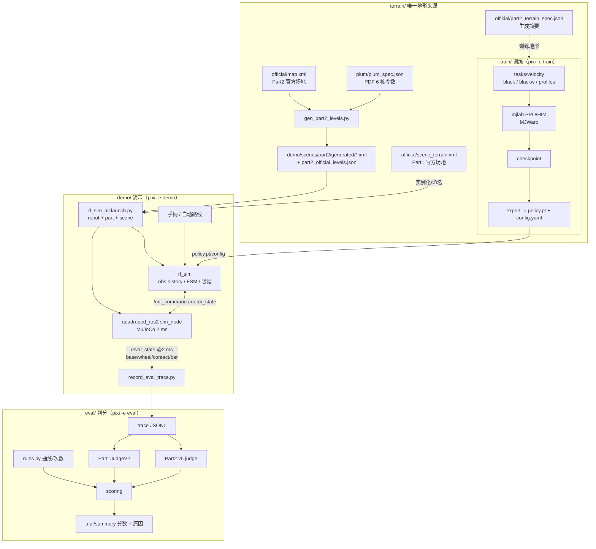
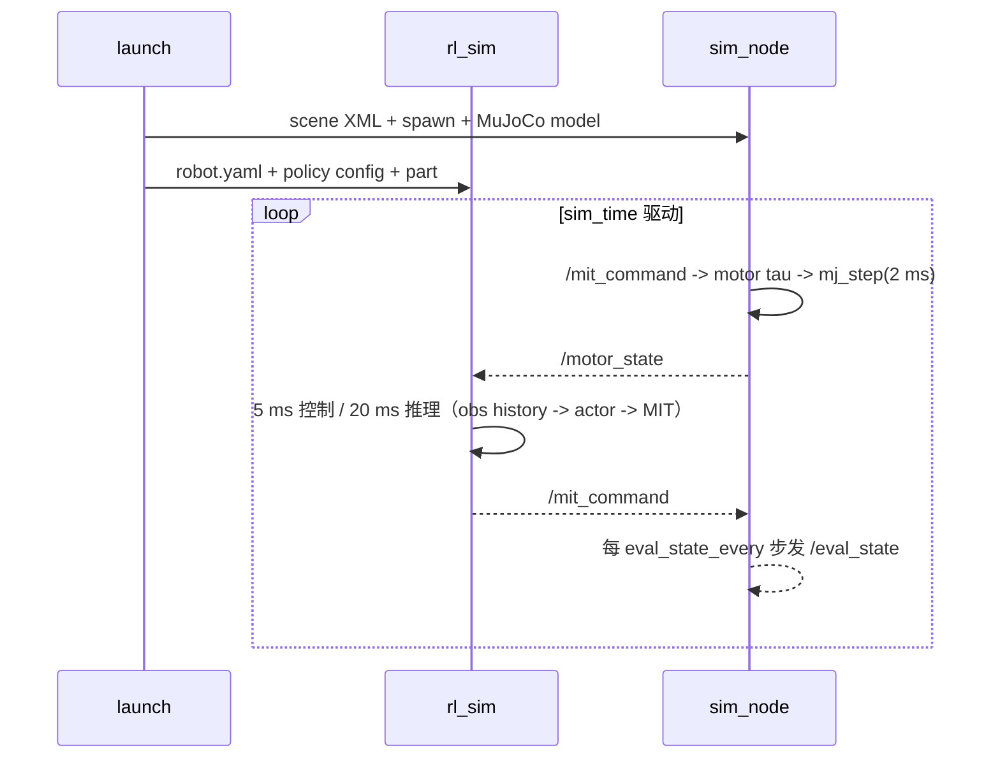

# 架构与数据流

本文件只描述新仓实际接在"能产生分数"链路里的结构；规则/判分口径见 `eval/SPEC.md` 与
`docs/RULES-BASIS.md`。若文档与代码冲突，以代码 + `eval/robocon_eval/rules.py` + 测试为准。

## 1. 总体数据流



三条流水线共享的只有：MuJoCo 3.11 物理、机器人 MJCF/`robot.yaml`、obs/action 契约、
`terrain/` 地形数据、judge 判据。训练/评测/部署不共享运行时进程。

## 2. 坐标与契约（cross-pipeline contract）

| 契约 | 唯一来源 | 使用方 |
|---|---|---|
| 物理步长 2 ms、控制 5 ms、策略 50 Hz | 官方 MJCF `<option timestep="0.002"/>` + `robot.yaml` | train / demo / eval |
| obs 57×6（blackW，term-major→export frame-major）、action 16 | `robot.yaml` + policy `config.yaml` | train export / demo / eval |
| 机器人关节顺序、轮索引、kp/kd、默认姿态、力矩上限 | `demo/robots/<robot>/robot.yaml` | 全部 |
| Part1/Part2 判分曲线、尝试次数 | `eval/robocon_eval/rules.py` | eval、train 的成功谓词 |
| 场景/关卡 | `terrain/` 生成 → `demo/scenes/` | demo / eval |
| trace schema（2 ms 帧） | `eval/SPEC.md` + `demo/tests/record_eval_trace.py` | demo → eval |

坐标系：MuJoCo world（x 前进，y 左，z 上）；Part2 单关场景把障碍平移到通道中线 y=0，
出生点 x=0；Part1 用官方世界坐标（起点 (3.7, -9.0)）。判分 lane 用 world y。

## 3. 训练流水线

- `train/src/alldog_mjlab/tasks/velocity/`：`black`、`blackw` 两族任务 + `profiles/{common,part1,part2}`。
- Terrain 由 `train/.../profiles/part2` 读取 `terrain/official/part2_terrain_spec.json`（单一来源，
  不再保留副本）。
- 算法：核心 PPO / HIM；研究分支（BC、depth student、gated CNN 等）未迁入。
- 导出：`scripts/export` → TorchScript `policy.pt` + `config.yaml` + `manifest.json`，
  复制到 `demo/rl_sar/policy/<robot>/<name>/`（权重不入库）。

## 4. 演示运行时



- 判分跑 **`eval_state_every:=1`（2 ms 一帧）**；普通演示可调大省 IO。
- Part1 可用手柄或 `route:=part1` 自动路线；Part2 只允许 RL，不能固定动作。Part2 全场演示
  `route:=part2` 一次启动走完六类（梅花桩 = 深度专家穿越 + 轮式专家下降，见
  [`part2/ROUTE.md`](part2/ROUTE.md)）。
- 深度相机（plum 深度专家）：`sim_node` 用 EGL 离屏渲染场景里的 `depth_cam`（64x48、公制平面
  深度、只画 geom group 0），每 `depth_every` 步发布 `/depth_cam`（默认 50 Hz，先于同一步
  `/motor_state`，同一 `d->time`）；`rl_sim` 按 `depth.json` 契约归一化后作为 TorchScript 的
  第二输入 `policy(obs_1d, [1x1xHxW])`。C++ 渲染与 eval 侧 `mujoco.Renderer` 逐位相同，
  C++ 推理与 Python 同输入同动作（`demo/tests/check_depth_inference.py`）。
- 策略热切换：`/policy_switch`（`std_msgs/String` = policy 目录名）由 `rl_sim` 直接加载
  TorchScript（~3 ms），路线用它做深度专家/下降专家的切换；手柄组合键仍保留。
- 场景来源：Part1 `demo/robots/blackW/scene_part1.xml`（官方几何 148 个 primitive 与
  `terrain/official/scene_terrain.xml` 一一对应），Part2 `demo/scenes/part2/generated/*.xml`。

## 5. 判分链路

- Part1：`record_eval_trace.py`（或 in-process `policy_runner`）→ `trace.replay_part1` →
  `Part1JudgeV2`（逐障碍证据 + AttemptManager）→ `scoring`。
- Part2：v5 judge 输入 base/tilt/wheel_x/y/z；每关独立场景与 judge 参数（manifest 的 `judge`）；
  成功 = 障碍支撑证据 + hold（官方口径，见 SPEC）。
- 未来接口：judge 直接吃 `mjData`（接触对/几何位姿），用于"任何瞬间"检查与限高杆几何净空；
  当前先保持 trace 输入与现有逻辑。

## 6. Part1 MPC（规划中）

Part1 规则允许自动/固定动作，MPC 不进 Part2 正式计分环：

```
参考路径(waypoints) ─► SE(2)/差速 MPC ─► (vx, wz) ─► 现有 RL 速度策略 ─► sim
        ▲                                   │
        └──── 允许的导航真值（位置/速度） ◄──┘
```

- 第一层只替换 `part1_auto_route` 的 P 控制器；模型/求解器放 `tools/mpc/`。
- 不重写 RL 策略；整机动力学仅用于预测，不作为最终控制输出。
- 评价：同一路线/同一策略下对比 pure-pursuit 基线（航向/位姿误差、衔接时间、成功率）。
